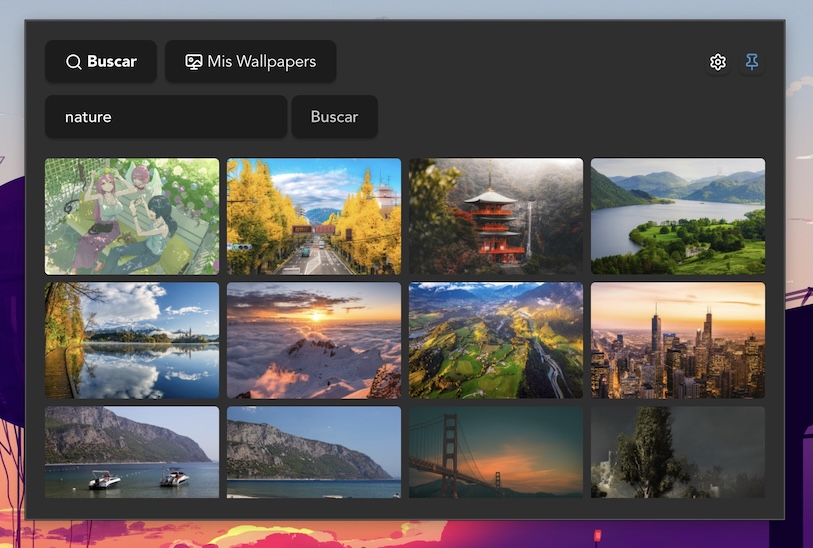

# Wallhaven Picker

App de barra de menú para macOS que permite buscar y aplicar wallpapers desde [Wallhaven](https://wallhaven.cc) sin salir del teclado ni abrir el navegador.



## ¿Qué hace?

- Vive como un ícono en la barra de menú (menu bar), sin aparecer en el Dock
- Busca wallpapers por keyword directamente desde la API de Wallhaven
- Filtra automáticamente por la resolución nativa de tu pantalla (activable/desactivable)
- Vista tipo slideshow para navegar entre resultados con preview grande
- Aplica el wallpaper seleccionado directamente al escritorio con un click
- Guarda localmente cada wallpaper aplicado en `~/WallhavenPicker/Wallpapers`
- Pestaña "Mis Wallpapers" para ver y reaplicar wallpapers ya descargados, sin volver a buscar
- Gestión de almacenamiento: ver cuánto espacio ocupan tus wallpapers guardados y limpiarlo con un click

## Stack

- **[Tauri](https://tauri.app)** — runtime nativo (Rust) + webview
- **React + TypeScript** — interfaz
- **Wallhaven API** — fuente de los wallpapers
- **AppleScript (vía `osascript`)** — aplicar el wallpaper al sistema, ya que macOS no expone una API nativa simple para esto

## Requisitos

- macOS
- Node.js
- Rust (`rustup`)
- Xcode Command Line Tools

## Desarrollo

```bash
pnpm install
pnpm tauri dev
```

## Cómo funciona (resumen técnico)

- El ícono de la barra de menú controla la visibilidad de una única ventana (popover), que se oculta automáticamente al perder el foco
- La app corre con política de activación `Accessory` de macOS, para no aparecer en el Dock ni cerrarse al ocultar la ventana
- Las búsquedas usan el plugin `http` de Tauri contra la API pública de Wallhaven (`wallhaven.cc/api/v1/search`)
- Los wallpapers aplicados se descargan a `~/WallhavenPicker/Wallpapers` (carpeta propia en el home, sin restricciones de permisos de macOS) y se aplican corriendo un script de AppleScript vía el plugin `shell`
- Las preferencias (como el filtro de resolución) se persisten con el plugin `store` de Tauri

## Roadmap / ideas pendientes

- Filtro de categorías y purity (SFW/Sketchy/NSFW) con soporte de API key
- Rotación automática de wallpaper (slideshow real, no solo preview)
- Favoritos / colecciones

---

Proyecto personal, hecho para dejar de entrar a Wallhaven manualmente cada vez que quiero cambiar de fondo de pantalla.